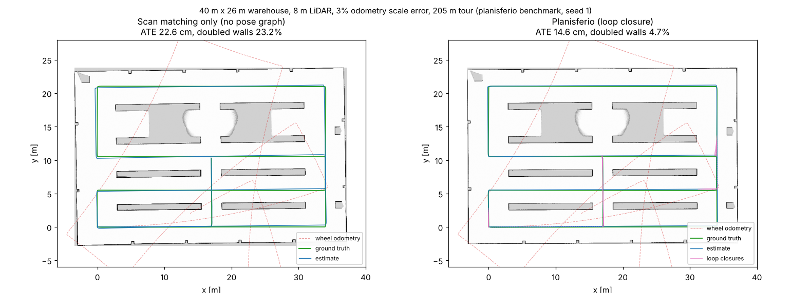

# Planisferio

**2D LiDAR SLAM for ROS 2: a particle-filter front-end, a pose-graph back-end and loop closure.**

Planisferio builds an occupancy-grid map of a building from a 2D LiDAR and wheel
odometry, and keeps the robot localized in it while it moves. When the robot
returns to a place it has already mapped, Planisferio recognizes it, measures
the accumulated error by scan matching, spreads the correction over the whole
trajectory and redraws the map, so walls seen twice are drawn once.

It is written from scratch in Python and NumPy, with no SLAM library. The
algorithms live in a ROS-free core that can be tested and benchmarked offline.
A single ROS 2 node connects that core to the usual inputs and outputs:

1. a `sensor_msgs/LaserScan` topic,
2. a `nav_msgs/Odometry` topic and its TF (`odom -> base_link`),
3. the LiDAR mounting in TF (`base_link -> laser`), or three parameters.

It publishes a standard `nav_msgs/OccupancyGrid` and the `map -> odom`
transform, so any navigation stack that reads a map works with it, including
[Sendero](https://github.com/raymundo140/sendero-ros2) for navigation and
[Frontera](https://github.com/raymundo140/frontera-ros2) for autonomous
exploration.



## Mechanisms

| Mechanism | What it does |
|---|---|
| Particle-filter front-end | Every scan, the odometry increment moves a cloud of particles with a sampled motion model. Each particle is scored with a likelihood field of the map, the cloud is resampled when its effective size drops, and the weighted mean is the corrected pose. The front-end runs in a few milliseconds per scan. |
| Local front-end map | The front-end matches against the last ~20 m of travelled path only, not against the whole map. Drift therefore stays visible when the robot comes back to an old place, instead of being hidden in one sudden snap, and the back-end can spread it correctly. Old keyframes leave the local map exactly, by subtracting their own log-odds update. |
| Keyframes and pose graph | Every 15 cm or 10 degrees a keyframe stores the pose and the scan. Consecutive keyframes are joined by an edge whose uncertainty is anisotropic in the robot frame (along the direction of travel, sideways, heading) and grows with distance and rotation. |
| Loop detection | Keyframes near the current position in (x, y), but far back along the travelled path, are loop candidates. A candidate is accepted only if a correlative scan match against its submap scores high and most points land on old walls, so similar aisles are not confused. |
| Correlative scan matching | An exhaustive search over a window of translations and rotations, made about 100 times cheaper by branch and bound over a coarse upper-bound table. It finds the answer even when the error is too large for a local optimizer, and its score landscape gives the covariance of the match, weak along corridors and strong across them. |
| Robust optimization | Gauss-Newton with Levenberg-Marquardt damping on the sparse pose graph. Loop edges use a Huber kernel, and after convergence any loop edge above the 99.9% chi-square bound is rejected as an outlier and the graph is optimized again without it. |
| Background back-end | Loop detection, optimization and the map rebuild run in a background thread. While it works on keyframes 0..K the front-end keeps adding K+1..N; the result is applied at the next scan by moving the newer keyframes and the particles rigidly with keyframe K. The front-end never stops. |
| Map output | A log-odds grid that grows as the robot explores, published as a standard occupancy grid (0..100, -1 unknown) and saved on request in the map_server format (PGM + YAML). |

## ROS 2 interface

`<ns>` is the `namespace` parameter (default `/slam`). Every topic name is a parameter.

| Direction | Name | Type | Notes |
|---|---|---|---|
| in | `scan_topic` (`/scan`) | `sensor_msgs/LaserScan` | Any 2D LiDAR; any number of beams |
| in | `odom_topic` (`/odom`) | `nav_msgs/Odometry` | Frames are taken from its header unless set |
| in | TF `base -> laser` | | LiDAR mounting; `laser_x/y/yaw` are the fallback |
| out | `map_topic` (`/map`) | `nav_msgs/OccupancyGrid` | Transient local, 1 Hz |
| out | TF `map -> odom` | | 20 Hz; jumps by each correction, odometry stays smooth (REP 105) |
| out | `<ns>/pose` | `geometry_msgs/PoseWithCovarianceStamped` | Corrected pose, every scan |
| out | `<ns>/path` | `nav_msgs/Path` | Keyframe trajectory, republished after every correction |
| out | `<ns>/graph` | `visualization_msgs/MarkerArray` | Keyframes, odometry edges, loop closures |
| out | `<ns>/particles` | `geometry_msgs/PoseArray` | Debug |
| out | `<ns>/scan` | `sensor_msgs/LaserScan` | The scan as used, debug |
| out | `<ns>/status` | `std_msgs/String` | One line of `key=value` pairs at 1 Hz (state, scan rate, keyframes, loops, map size, pose), for supervisors and dashboards |
| service | `<ns>/reset` | `std_srvs/Trigger` | Start a new map |
| service | `<ns>/save_map` | `std_srvs/Trigger` | Save `<save_dir>/<prefix>_<date>_<time>.pgm/.yaml` |
| service | `<ns>/optimize` | `std_srvs/Trigger` | Force an optimization and map rebuild |

## Install

Requirements: ROS 2 Humble or Jazzy, NumPy, SciPy (recommended: without it the
pose-graph solve falls back to a dense solver, fine up to about 1200 keyframes).

```bash
mkdir -p ~/ros2_ws/src && cd ~/ros2_ws/src
git clone https://github.com/raymundo140/planisferio-ros2.git
cd ~/ros2_ws
rosdep install --from-paths src --ignore-src -y
colcon build --symlink-install
source install/setup.bash
```

## Quick start

```bash
# real robot
ros2 launch planisferio planisferio.launch.py params_file:=/path/to/my_robot.yaml

# simulation, with RViz
ros2 launch planisferio planisferio.launch.py params_file:=/path/to/my_robot.yaml \
    use_sim_time:=true rviz:=true

# save the map
ros2 service call /slam/save_map std_srvs/srv/Trigger
```

Drive the robot around. The log reports every loop closure and every correction
applied. In RViz, pink lines appear between the old and the new pass, and
doubled walls merge into one.

## Configuration

Every setting is a ROS 2 parameter, documented line by line in
[`planisferio/config/planisferio.yaml`](planisferio/config/planisferio.yaml).
Section 1 is robot-specific and must be reviewed for every new robot: topics,
frames, the LiDAR mounting and how much of each scan to use. The other sections
hold algorithm settings with tested starting values.

To adapt Planisferio to your robot, copy `planisferio.yaml` next to your own
launch files, keep only what differs from the defaults, and pass it with
`params_file:=`. The package itself never needs to change.

Checklist for a new robot:

1. `scan_topic`, `odom_topic`, and the frames (or leave `odom_frame` and
   `base_frame` empty to take them from the odometry message).
2. Publish `base_link -> laser` in TF (a URDF or a static transform), or set
   `laser_x`, `laser_y`, `laser_yaw`.
3. `map_max_range` and `match_max_range` at or below the range your LiDAR
   measures reliably, and `local_map_window` at about twice that range.
4. If your odometry is poor, raise `motion_alphas`.
5. On a small computer (for example a Jetson), lower `num_particles` and
   `match_beams`, or raise `map_beam_step`, and install SciPy.

### Tuning

| Symptom | Likely cause | Fix |
|---|---|---|
| No loop closures in the log | Drift larger than the search window, or not far enough along the path | Raise `loop_search_radius` and `loop_match_window`; check `loop_min_path` |
| Closures found but rejected as outliers | Repetitive aisles matched to the wrong one | Raise `loop_min_score` and `loop_min_inliers`; lower `loop_match_window` |
| Map rebuilds very often | Every small closure triggers a rebuild | Raise `loop_trigger_xy` and `loop_rebuild_min_correction` |
| Front-end slower while a rebuild runs | Python threads share the CPU | Expected; raise `loop_check_every` or `map_beam_step` |
| Corridors come out stretched | Local map shorter than about twice the LiDAR range | Raise `local_map_window` |
| A correction bends straight corridors | Odometry edges too loose in heading or sideways | Lower `seq_sigma_theta*` and `seq_sigma_cross*` |
| Loops close but the map is slightly too long or short | A global scale error, which loop closure cannot observe | Calibrate the wheel radius and separation |
| Pose jumps or the map smears while turning | Odometry and scans out of sync, or a wrong LiDAR mounting | Check the TF `base -> laser`, the timestamps and `max_odom_gap` |

## Benchmark

`ros2 run planisferio benchmark` runs the core without ROS on simulated data
with ground truth. A LiDAR mounted with an offset is ray-cast in a 2D world,
and the wheel odometry has a 3% scale error, a 4% rotation error and noise. All
configurations see identical data. ATE is the RMS position error of the
trajectory; *doubled walls* is the fraction of occupied cells more than 15 cm
from a real wall after removing the global scale error, that is, walls drawn
twice or bent.

```bash
ros2 run planisferio benchmark                 # 40 x 26 m warehouse, all configurations
ros2 run planisferio benchmark --world small   # 20 x 12 m
ros2 run planisferio benchmark --modes global-map loop --seed 3 --beams 3600
```

Results: 40 x 26 m warehouse with four long rack rows, an 8 m LiDAR, and a 205 m
tour that revisits the corridors (14.5 m of odometry error by the end).
*Scan matching only* is the front-end matched against the whole map without a
pose graph.

| Dataset | ATE, scan matching only | ATE, Planisferio | Doubled walls, scan matching only | Doubled walls, Planisferio |
|---|---|---|---|---|
| Large, seed 1 | 22.6 cm | 14.6 cm | 23.2% | 4.7% |
| Large, seed 2 | 6.0 cm | 4.0 cm | 0.0% | 0.0% |
| Large, seed 3 | 17.1 cm | 12.8 cm | 11.3% | 0.5% |
| Large, seed 3, back-end in a thread at real-time speed | 17.1 cm | 15.5 cm | 11.3% | 4.4% |
| Small 20 x 12 m | 8.9 cm | 8.0 cm | 0.0% | 0.0% |

Timing on a laptop CPU with 720-beam scans: front-end 6 to 10 ms per scan
(95th percentile 18 to 24 ms with the back-end running beside it), loop
verification 40 to 60 ms per match, optimization of 1300 keyframes 12 to 30 ms,
map rebuild 2.7 to 4.8 s in the background.

## How it works

**Front-end.** Below `update_min_d` / `update_min_a` of motion the pose simply
follows the odometry. Otherwise the particles are moved with the odometry
increment and a sampled motion model (Thrun et al., ch. 5), weighted with a
likelihood field of the local map (a bounded distance transform, ch. 6),
resampled systematically when the effective sample size falls below
`resample_ratio`, and averaged into the corrected pose and its covariance.

**Edges between keyframes.** The relative pose between consecutive keyframes is
an edge with an anisotropic covariance in the robot frame. It was calibrated
against ground truth over hundreds of keyframes rather than single steps: the
front-end keeps re-matching the local map, so its heading errors partly cancel
(0.10 degrees per step but only 0.36 degrees after 500 steps, where a random
walk would reach 2.1 degrees). A model built from single steps was two to three
times too loose in heading, and the optimizer then "fixed" loops by bending
corridors. The front-end is also about three times less certain along the
direction of travel than sideways, because corridors constrain the robot
laterally but not along their length.

**Loop verification.** The new scan is matched against a submap made of the
candidate keyframe and its neighbours along the path. The submap is rasterized
into a lookup table S(c) = exp(-d(c)^2 / 2 sigma^2), where d is the distance
from cell c to the nearest submap point, and a candidate pose scores the mean of
S over the transformed scan (Olson, 2009). A coarse table holding the maximum of
S over 4 x 4 blocks bounds every fine translation inside a block, so blocks are
expanded only while they can beat the best score (Hess et al., 2016). The result
equals the exhaustive search.

**Optimization.** For an edge (i, j) with measurement z, the error is the
difference between z and the relative pose the current estimate predicts
(Grisetti et al., 2010). The sparse normal equations H dx = -b, with
H = sum J^T Omega J, are solved repeatedly; node 0 is fixed because it defines
the map frame. A loop edge pulls its two ends together and every edge in
between gives way in proportion to its uncertainty, which spreads the loop
error over the loop. The analytic Jacobians are checked against numerical
derivatives in the tests.

**When to optimize.** A new loop edge that disagrees with the estimate by more
than `loop_trigger_xy` or `loop_trigger_theta` triggers an optimization at once;
smaller closures are stored and optimized after `loop_max_pending` of them. The
map is rebuilt from every keyframe at its optimized pose only if a pose moved by
more than `loop_rebuild_min_correction`.

**Limits.** Loop closure enforces consistency: a place seen twice is drawn once.
It cannot observe a uniform scale error, because a rectangle that is 0.5% too
long still closes perfectly. In the benchmark, most of what remains after loop
closure is such a scale error inherited from the odometry in long corridors,
where the LiDAR cannot measure progress. Calibrating the wheel radius and
separation removes it. Planisferio is a 2D SLAM: it assumes a flat floor and a
horizontal LiDAR.

## Tests

The core and the node logic are tested without ROS:

```bash
cd planisferio-ros2/planisferio
python3 -m pytest test/ -v
# or, after colcon build:
colcon test --packages-select planisferio && colcon test-result --verbose
```

They cover the SE(2) algebra, the pose-graph Jacobians against numerical
derivatives, closing a drifting loop, rejecting a false loop closure, the scan
matcher on a known offset, the occupancy grid and its growth, saving a map,
that the parameter file and the node declare exactly the same parameters, and
an end-to-end run on simulated data with ground truth (synchronous and
threaded back-end).

## References

- S. Thrun, W. Burgard, D. Fox, *Probabilistic Robotics*, MIT Press, 2005.
- G. Grisetti, R. Kümmerle, C. Stachniss, W. Burgard, "A tutorial on graph-based SLAM,"
  *IEEE Intelligent Transportation Systems Magazine*, 2010.
- E. Olson, "Real-time correlative scan matching," *Proc. IEEE ICRA*, 2009.
- W. Hess, D. Kohler, H. Rapp, D. Andor, "Real-time loop closure in 2D LIDAR SLAM,"
  *Proc. IEEE ICRA*, 2016.
- K. Konolige et al., "Efficient sparse pose adjustment for 2D mapping," *Proc. IEEE/RSJ IROS*, 2010.

## License

MIT. See [LICENSE](LICENSE).
